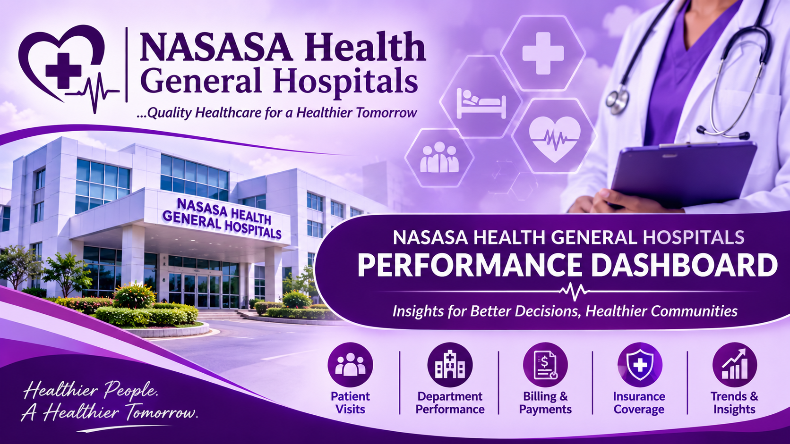

# NASASA HEALTH HOSPITAL DATASET ANALYSIS

## Introduction

Healthcare institutions collected large volumes of data last year through patient admissions, medical consultations, billing activities, insurance claims, and other hospital operations. Analysing this data will provide valuable insights into NASASA hospital performance and support effective management decision-making for the following year.

This project focuses on the analysis of patient data from NASASA HEALTH HOSPITAL using Microsoft Excel. The objective is to transform raw hospital data into meaningful insights through thorough data cleaning, proper analysis, and interactive visualisation.

An interactive dashboard was developed to provide management with a clear overview of patient visits, departmental performance, billing activities ranging from those who have fully paid , partially paid and outstanding payment, patient demographics, insurance coverage, and admission trends.

The project demonstrates the application of Microsoft Excel in healthcare data analytics, with an emphasis on data-driven decision-making and operational performance monitoring.

